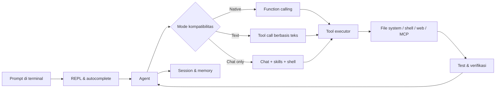

<div align="center">

# CodinX

### Terminal coding agent yang benar-benar bekerja bersama kamu.

Tulis kode. Jalankan perintah. Baca error. Perbaiki proyek.
Semua dari terminal — dengan streaming, tools, skills, memory, dan kontrol penuh di tanganmu.

<p>
  <a href="https://github.com/muhammadfahri190713-afk/CodinXGPT"></a>
  <a href="https://github.com/muhammadfahri190713-afk/CodinXGPT/blob/main/LICENSE"></a>
  <a href="https://www.python.org/downloads/"></a>
  <a href="https://github.com/muhammadfahri190713-afk/CodinXGPT/actions"></a>
</p>

<p>
  <a href="#mulai-dalam-60-detik">Mulai cepat</a> ·
  <a href="#fitur-utama">Fitur</a> ·
  <a href="#perintah-penting">Perintah</a> ·
  <a href="docs/CONFIG.md">Konfigurasi</a> ·
  <a href="#dokumentasi">Dokumentasi</a>
</p>

</div>

---

## Mengapa CodinX?

CodinX adalah coding agent berbasis terminal untuk Linux, container, dan Termux. Ia tidak hanya menghasilkan jawaban: CodinX dapat membaca repository, mengubah file, menjalankan test, memeriksa hasil, lalu melanjutkan pekerjaan berdasarkan feedback nyata dari proyekmu.

```text
┌──────────────────────────────────────────────────────────────────┐
│  CodinX  ·  terminal coding agent                               │
│                                                                  │
│  prompt → model → tools → filesystem / shell / web / MCP        │
│                  ↑                         │                     │
│                  └──── session · memory · skills · hooks ──────┘
└──────────────────────────────────────────────────────────────────┘
```

### Cocok untuk

- memperbaiki bug dari traceback atau failing test;
- memahami codebase lama sebelum melakukan perubahan;
- membuat fitur dengan mode **build** atau merancangnya dulu dengan **plan**;
- menjalankan workflow berulang melalui skills, commands, hooks, dan sub-agent;
- bekerja di perangkat yang ringan — termasuk Termux tanpa root.

## Mulai dalam 60 detik

### 1. Clone dan siapkan konfigurasi

```bash
git clone https://github.com/muhammadfahri190713-afk/CodinXGPT.git
cd CodinXGPT
cp api.example.py api.py
```

Edit `api.py`, lalu isi API key milikmu. File ini bersifat lokal dan sudah dilindungi `.gitignore`.

> Alternatif yang lebih aman untuk deployment: gunakan `CODINX_API_KEY` dan `CODINX_BASE_URL` melalui environment atau `.env` lokal.

### 2. Jalankan langsung

```bash
python3 bin/codinx
```

### 3. Atau pasang command global

```bash
bash install.sh
codinx
```

Installer mendeteksi Linux, container, dan Termux secara otomatis. Untuk Termux, `$PREFIX` digunakan sebagai lokasi instalasi.

### 4. Coba perintah pertama

```text
> baca repository ini, jelaskan arsitekturnya, lalu jalankan test yang relevan
```

Mode non-interaktif juga tersedia:

```bash
codinx run "buat ringkasan struktur proyek ini" --auto
codinx run -c "lanjutkan pekerjaan sebelumnya"
codinx run "/skill debug-fix error ini" --auto
codinx run "cek status proyek" --format json
```

## Fitur utama

<table>
<tr>
<td width="50%">

### Agent coding

- membaca dan menulis file;
- edit terarah dan multi-edit;
- menjalankan shell dengan kontrol izin;
- menjalankan test dan menganalisis error;
- mode build dan plan;
- compact otomatis saat konteks mendekati batas.

</td>
<td width="50%">

### Tool calling yang tangguh

- native function calling;
- text-based tool fallback;
- deteksi kompatibilitas proxy per model;
- fallback saat streaming ditolak;
- dukungan format OpenAI, Anthropic, dan Gemini;
- kompatibilitas gateway yang hanya mengirim pesan terakhir.

</td>
</tr>
<tr>
<td>

### Terminal UX

- popup suggestion saat mengetik `/`;
- autocomplete untuk commands, skills, argumen, dan `@file`;
- Tab, ↑↓, Enter, Esc;
- syntax highlighting;
- tema, desain, banner, spinner, border, prompt;
- tampilan adaptif untuk terminal sempit.

</td>
<td>

### Workflow yang bisa dikembangkan

- 40+ skills bawaan;
- sub-agent;
- commands dan project instructions;
- hooks;
- MCP server;
- memory jangka panjang;
- session tersimpan, resume, export, undo, dan redo.

</td>
</tr>
<tr>
<td>

### Multi-endpoint

- endpoint OpenAI-compatible;
- preset Manus;
- koneksi custom;
- katalog model live;
- model trial dan paket Free/Pro/Max;
- fallback assistant opsional.

</td>
<td>

### Aman secara default

- API key tidak disimpan ke `config.json`;
- `api.py`, `.env`, dan key terenkripsi di-ignore;
- secret scanner;
- permission per tool;
- hard-deny untuk perintah destruktif;
- installer memverifikasi package API sebelum mengganti instalasi.

</td>
</tr>
</table>

## Alur kerja CodinX



## Perintah penting

| Perintah | Kegunaan |
|---|---|
| `codinx` | Membuka sesi interaktif |
| `codinx run "..."` | Menjalankan satu prompt tanpa REPL |
| `codinx run --format json "..."` | Output terstruktur untuk automation |
| `/help` | Daftar perintah dan tool |
| `/models` | Melihat model yang tersedia |
| `/connect` | Mengatur endpoint dan API key |
| `/doctor` | Mendiagnosis kompatibilitas proxy/model |
| `/theme` | Memilih tema dengan preview |
| `/design` | Mengatur atau menyimpan preset desain |
| `/skills` | Menjelajah skills yang tersedia |
| `/skill <nama>` | Menjalankan skill tertentu |
| `/plan` | Masuk ke mode read-only planning |
| `/new` | Memulai session baru |
| `/sessions` | Melihat session tersimpan |
| `/undo` / `/redo` | Membatalkan atau mengulang perubahan |
| `/diff` | Melihat perubahan proyek |
| `/export` | Mengekspor percakapan |
| `@file` | Melampirkan file ke konteks prompt |
| `!perintah` | Menjalankan shell dari dalam sesi |
| `/permissions` | Mengatur kebijakan izin tool |
| `/admin_panel` | Melihat panel admin lokal |

Daftar lengkap tersedia di [docs/COMMANDS.md](docs/COMMANDS.md).

## Konfigurasi

CodinX menggunakan prioritas berikut untuk koneksi:

```text
environment  >  api.py  >  .env legacy  >  ~/.codinx/config.json
```

### Konfigurasi lokal `api.py`

```python
API_KEY = "isi_api_key_kamu"
BASE_URL = "https://inttelix.vercel.app/api/v1"
```

### Environment

```bash
export CODINX_API_KEY="..."
export CODINX_BASE_URL="https://inttelix.vercel.app/api/v1"
export CODINX_MODEL="deepseek-v4-flash"
export CODINX_TRIAL=1
```

Variabel yang berguna:

| Variabel | Fungsi |
|---|---|
| `CODINX_API_KEY` | API key tanpa menulisnya ke config |
| `CODINX_BASE_URL` | Endpoint API |
| `CODINX_MODEL` | Model aktif |
| `CODINX_TRIAL` | `1` membuka trial; `0` memakai aturan paket |
| `CODINX_TOOL_MODE` | `auto`, `native`, `text`, atau `none` |
| `CODINX_HISTORY_MODE` | `auto`, `native`, atau `flat` |
| `CODINX_AUTO_PROBE` | Diagnosa proxy otomatis |
| `CODINX_DEBUG` | Mengaktifkan debug log yang sudah disanitasi |
| `CODINX_HOME` | Lokasi data CodinX |
| `CODINX_SIMPLE_INPUT` | Memakai `input()` tanpa popup |

Lihat seluruh opsi di [docs/CONFIG.md](docs/CONFIG.md).

## Trial, paket, dan model

Mode trial aktif secara default untuk development: seluruh katalog model dapat dicoba tanpa pemotongan Dinar. Untuk memakai aturan paket Free/Pro/Max, jalankan:

```bash
export CODINX_TRIAL=0
```

Pembatasan paket di sisi client bukan pengganti enforcement di proxy. Untuk penggunaan produksi, enforcement tetap harus dilakukan di sisi server.

## Kompatibilitas proxy

Tidak semua gateway OpenAI-compatible berperilaku sama. CodinX dapat menyesuaikan diri saat model atau proxy:

- menolak streaming;
- tidak mendukung function calling;
- hanya membaca pesan terakhir;
- membutuhkan mode history `flat`;
- menggunakan field conversation ID yang berbeda;
- mengembalikan format SSE OpenAI, Anthropic, atau Gemini.

Mulai diagnosis dengan:

```text
/doctor
```

Panduan detail: [docs/PROXY_COMPAT.md](docs/PROXY_COMPAT.md).

## Keamanan

Jangan pernah commit API key atau file konfigurasi lokal.

```bash
# Pasang hook keamanan
bash scripts/install-git-hooks.sh

# Scan repository sebelum push
python3 scripts/secret_scan.py .
```

Checklist sebelum publish:

- `api.py` tetap lokal dan tidak staged;
- `.env` tidak ikut commit;
- key terenkripsi tidak ikut commit;
- secret scanner lulus;
- log debug tidak berisi API key;
- endpoint produksi memakai TLS yang valid.

Baca [SECURITY.md](SECURITY.md) dan [docs/GITHUB.md](docs/GITHUB.md) sebelum membagikan deployment.

## Development

```bash
# Jalankan seluruh test suite
make test

# Scan secret
make scan

# Regenerasi dokumentasi
make docs

# Buat package ZIP
make zip
```

CodinX saat ini memiliki **349 test** untuk config, auth, API streaming, proxy compatibility, tools, skills, PTY UI, Termux, security, dan workflow.

### Struktur proyek

```text
CodinXGPT/
├── bin/codinx          # launcher
├── cx/                 # source utama agent
│   ├── agent.py        # loop agent dan tool calls
│   ├── api.py          # client API OpenAI-compatible
│   ├── app.py          # REPL dan command router
│   ├── config.py       # konfigurasi dan secret sources
│   ├── lineedit.py     # input editor dan autocomplete
│   └── ...
├── commands/           # command markdown
├── skills/             # skills bawaan
├── agents/             # sub-agent instructions
├── docs/               # dokumentasi teknis
├── examples/           # contoh konfigurasi
├── scripts/            # utility, scanner, dan build scripts
└── tests/              # regression dan integration tests
```

Arsitektur lebih detail: [docs/ARCHITECTURE.md](docs/ARCHITECTURE.md).

## Dokumentasi

| Topik | Dokumentasi |
|---|---|
| Arsitektur | [docs/ARCHITECTURE.md](docs/ARCHITECTURE.md) |
| Perintah | [docs/COMMANDS.md](docs/COMMANDS.md) |
| Konfigurasi | [docs/CONFIG.md](docs/CONFIG.md) |
| Kompatibilitas proxy | [docs/PROXY_COMPAT.md](docs/PROXY_COMPAT.md) |
| Permission system | [docs/PERMISSIONS.md](docs/PERMISSIONS.md) |
| Desain terminal | [docs/DESIGN.md](docs/DESIGN.md) |
| Linux dan Termux | [docs/TERMUX.md](docs/TERMUX.md) |
| Skills | [docs/SKILLS.md](docs/SKILLS.md) |
| Sub-agent | [docs/SUBAGENTS.md](docs/SUBAGENTS.md) |
| Hooks | [docs/HOOKS.md](docs/HOOKS.md) |
| MCP | [docs/MCP.md](docs/MCP.md) |
| Troubleshooting | [docs/TROUBLESHOOTING.md](docs/TROUBLESHOOTING.md) |
| Publish ke GitHub | [docs/GITHUB.md](docs/GITHUB.md) |
| Contoh konfigurasi | [examples/README.md](examples/README.md) |
| Changelog | [CHANGELOG.md](CHANGELOG.md) |

## Kontribusi

Pull request dan issue sangat diterima. Sebelum membuka PR:

```bash
python3 scripts/secret_scan.py .
make test
git diff --check
```

Baca [CONTRIBUTING.md](CONTRIBUTING.md) untuk konvensi kontribusi dan [LICENSE](LICENSE) untuk lisensi.

<div align="center">

### Bangun lebih cepat. Debug lebih dalam. Tetap di terminal.

<a href="https://github.com/muhammadfahri190713-afk/CodinXGPT">Star repository ini di GitHub</a> jika CodinX membantu workflow-mu.

</div>
